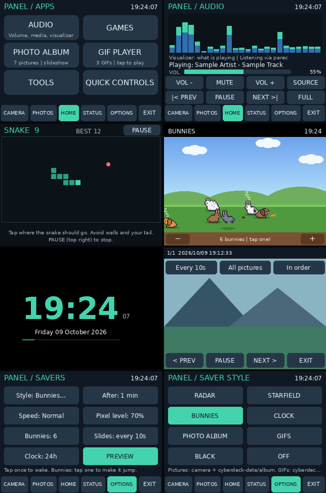
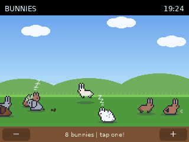
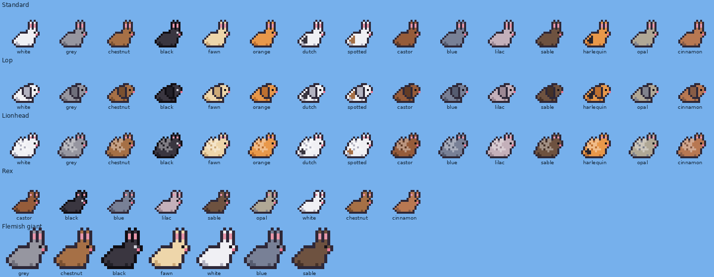
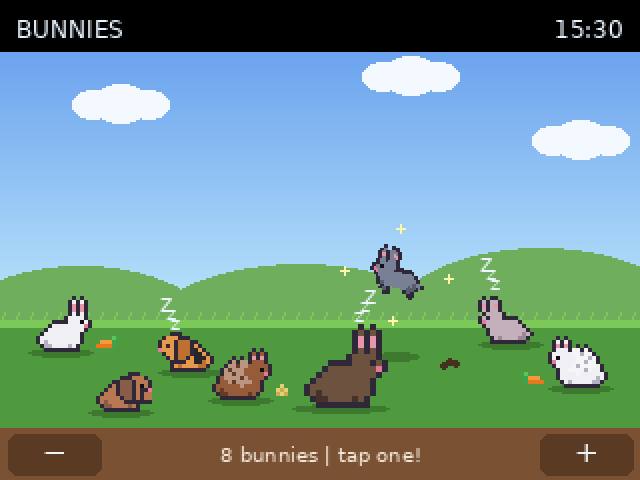

# Panel app: Apps tab, audio, Snake, photo album, GIFs and new screensavers





*Previews are drawn by the app's own code with sample data (the audio track, visualizer and photo are illustrative).*

## Install this update

1. Stop the panel app. If you set up the boot service, run `sudo systemctl stop cyberdeck-panel`; otherwise press Ctrl+C in its terminal.
2. Back up the current version:

```bash
cp ~/panel_app.py ~/panel_app.previous.py
```

3. From Windows PowerShell, copy the new version:

```powershell
scp panel_app.py eli@cyberdeck.local:/home/eli/
```

4. Optional: install the extra audio tools. Without them, the app still runs, but media keys and the "what is playing" visualizer stay unavailable:

```bash
sudo apt install playerctl pulseaudio-utils
```

5. Start the app again: `sudo systemctl start cyberdeck-panel` (or `sudo python3 ~/panel_app.py`).

No reboot is needed. Photos, calibration, options and the boot service carry over. The app creates three new folders the first time it runs:

| Folder | Put here |
| --- | --- |
| `~/cyberdeck-data/album/` | Extra pictures for the photo album (`.jpg`, `.jpeg`, `.png`) |
| `~/cyberdeck-data/gifs/` | `.gif` files for the GIF player and GIF screensaver |
| `~/cyberdeck-data/sprites/` | Optional custom bunny sprite (see below) |

To copy files from Windows:

```powershell
scp *.gif eli@cyberdeck.local:/home/eli/cyberdeck-data/gifs/
scp *.jpg eli@cyberdeck.local:/home/eli/cyberdeck-data/album/
```

## New tab layout

The tabs are now **CAMERA, PHOTOS, APPS, STATUS, OPTIONS, EXIT**. APPS opens four tiles: **Audio, Snake, Photo album, GIF player**.

## 1. Bunny screensaver (interactive)

Pixel bunnies hop across a grassy field under drifting clouds. Each bunny rests, then hops along; now and then one turns around.



**Every bunny is different.** Each one gets a random breed and coat:

| Breed | How often | Look | Coats |
| --- | --- | --- | --- |
| Standard | About 34% | Upright ears | All 15 coats |
| Lop | About 22% | Ears hang down beside the head | All 15 coats |
| Lionhead | About 16% | A shaggy, lighter mane around the head and neck | All 15 coats |
| Rex | About 14% | Shorter, broader ears on a plush body | Castor, black, blue, lilac, sable, opal, white, chestnut, cinnamon |
| Flemish Giant | About 14% | Drawn 1.5× larger. Moves a little slower and hops higher. | Grey, chestnut, black, fawn, white, blue, sable |

- **Coats:** white, grey, chestnut, black, fawn, orange, castor, blue, lilac, sable, opal and cinnamon, plus three marked coats: Dutch (black patches), spotted (brown patches) and harlequin (orange with black patches).
- **Bigger bunnies:** a giant's tap area matches its bigger size.
- **New bunnies:** ones added with **+** get their own random look.



**Bunnies have a life of their own.** Each time a bunny finishes resting, it usually hops on. Sometimes it does something else instead:

- **Snacking:** it lowers its head and nibbles a **carrot** or a tuft of **hay** for 4–8 seconds. The carrot is eaten from the tip; the hay gets smaller as it goes.
- **Napping:** it closes its eyes for 7–15 seconds while little **z**'s drift up.
- **Pooping:** it leaves one to three droppings behind. They sink into the grass and disappear after about 45 seconds, with at most 40 on screen.
- **Grooming:** it sits up and rubs a front paw over its face for 3–6 seconds, closing its eyes on each stroke.
- **Binky:** the happy rabbit leap. It springs about three times higher than a normal hop, tilts into the jump, twists its body round at the top, and lands nose-down with sparkles around it. Half the time it lands facing the other way.

Tapping a bunny still makes it jump with a heart, and that wakes a sleeper or interrupts a snack, a grooming session or a binky. A bunny in mid-binky can be tapped where it is in the air.

- **Shape:** the sitting pose is rounder and more compact than the first version, which had a long, flat torso.

- **Tap a bunny:** it does a big jump and a heart pops up. The saver stays on.
- **− / +** (bottom corners): change how many bunnies there are: 1, 3, 6, 12 or 24. The count is saved.
- **Tap the sky or grass:** wakes the panel, as with the other savers.
- You can also set the count in **OPTIONS -> Screensavers -> Bunnies**. **Speed** changes how fast they move.

**About the sprite:** I can't include the actual Terraria bunny. That sprite belongs to Re-Logic, and it isn't mine to redistribute. The built-in bunny is original pixel art drawn in the same style: a white body, pink inner ears, a sitting pose and a hopping pose. To use the real sprite, extract it from a copy of Terraria you own and save it as `~/cyberdeck-data/sprites/bunny.png`. If it holds several animation frames, add `~/cyberdeck-data/sprites/bunny.json`:

```json
{"frames": 7, "layout": "vertical", "scale": 2, "faces": "left"}
```

| Setting | Meaning |
| --- | --- |
| `frames` | How many frames the sheet holds. Frame 0 is shown while a bunny is resting; the rest animate while it hops. |
| `layout` | `vertical` if the frames are stacked top to bottom; `horizontal` if they sit side by side. |
| `scale` | Pixel enlargement, 1 to 4. |
| `faces` | The way the drawing faces. The app flips frames to suit the direction a bunny is moving. |

A sheet that doesn't match its settings is ignored, with a message in the terminal or journal, and the built-in bunnies are used instead. A valid custom sprite replaces all the breeds and coats; every bunny then uses your sprite.

## 2. Clock screensaver

A large clock with seconds, the day and full date, and a thin seconds-progress line. The clock shifts a few pixels each minute so the same pixels aren't lit all day. **OPTIONS -> Screensavers -> Clock** switches between 24 h and 12 h (12 h shows AM/PM). The time is the Pi's system time and time zone.

## 3. Audio control and visualizer

APPS -> **AUDIO**:

- **VOL - / VOL +** change volume in 5% steps, up to 100%. **MUTE** toggles mute. The bar and percentage show the current level.
- **|< PREV / PLAY / NEXT >|** control whichever media player is running (VLC, Chromium/YouTube, Spotify and others that support MPRIS). The track name is shown when the player provides it. These buttons need `playerctl`.
- **SOURCE** cycles the visualizer through:
  - **What is playing:** captures the speaker output. Needs `parec` (from `pulseaudio-utils`) or `pw-record`.
  - **Microphone:** uses `arecord` and needs a USB mic or sound card with an input. The Pi 4 has no built-in microphone.
  - **Off.**
- **FULL** shows a full-screen visualizer (spectrum bars plus waveform). Tap anywhere to return.

How it works and its limits:

- **Volume backend:** volume uses PipeWire's `wpctl` (the default audio system on current Raspberry Pi OS), falling back to ALSA `amixer` (`Master`, then `PCM`, and so on). The page shows which one it found.
- **Runs as your user:** the panel runs as root, but audio belongs to your desktop session. The audio tools are therefore run as your user, so they need your desktop session logged in (Raspberry Pi OS auto-login does this). Without it, the page shows *No volume control found*.
- **Only while open:** audio capture runs only while the Audio page or full-screen visualizer is open, and stops when you leave. Nothing is recorded or saved.
- **Approximate display:** the bars show 24 frequency bands from 60 Hz to 10 kHz on a 60 dB scale. They're a visual effect, not a calibrated meter.

## 4. Snake

APPS -> **SNAKE**, then **START**.

- **Steering:** tap the screen on the side you want the snake to go. It turns toward your tap, so tap above the head to go up, to the right to go right, and so on. Up to two turns can be queued. It can't reverse straight into itself.
- **Food:** eating grows the snake and speeds it up a little, from 5 to 12 moves per second.
- **Ending:** hitting a wall or your own tail ends the game.
- **PAUSE** is in the top right. The Paused, Game over and Start screens each offer two big buttons.
- **Best score** is saved in `~/cyberdeck-data/games.json`.

Taps register when your finger lifts, as everywhere else on this resistive screen. Short, firm taps work best. The screensaver never starts during a running game.

## 5. Photo album

APPS -> **PHOTO ALBUM** plays a full-screen slideshow with a short crossfade.

- Tap once to show the controls. They hide again after 5 seconds.
  - Bottom row: **< PREV**, **PAUSE/RESUME**, **NEXT >**, **EXIT**.
  - Top row: interval (**Every 5/10/30/60 s**); source (**All pictures**, **Camera only** or **Album folder**); order (**In order** or **Shuffled**). These are saved.
- The same slideshow is available as a screensaver: **Style -> PHOTO ALBUM**. It uses the same interval, source and order.
- If there are no pictures, it explains where to put them.

## 6. GIF player and GIF screensaver

APPS -> **GIF PLAYER** plays the GIFs in `~/cyberdeck-data/gifs/` full-screen at their own frame timing, letterboxed to fit.

- Tap to show **< PREV**, **PAUSE**, **NEXT >** and **EXIT**, plus the file name and frame count.
- As a screensaver (**Style -> GIFS**), each GIF plays for at least 20 seconds and one full loop, then the next one starts.
- **Speed limit:** the TFT tops out around 20 frames per second, and frames shorter than 40 ms are slowed to 40 ms.
- **Memory:** frames are decoded one at a time, so long GIFs don't fill memory. GIFs at or near 320x240 play most smoothly.
- **Bad files:** a broken file is skipped, with a message in the terminal or journal.

## Screensaver settings changes

**OPTIONS -> Screensavers** now has:

- **Style...:** opens a picker with **Radar, Starfield, Bunnies, Clock, Photo album, GIFs, Black, Off**.
- **After**, **Speed** and **Pixel level**, as before.
- New: **Bunnies** (count), **Slides** (album interval) and **Clock** (24 h/12 h).
- **PREVIEW**, as before.

Your previously chosen style and delay are kept. The health banner still appears over animated savers and the album and GIF modes. Black stays completely black.

## Checks

All 35 automated tests pass (`python3 -m unittest discover -s tests -v`):

- **Snake rules:** growing, wall and self collisions, moving into the cell the tail is leaving, and blocked reversal.
- **Snake controls:** tap steering toward the finger, and saving the best score.
- **Bunnies:** tap-to-jump hit testing, the −/+ count limits, staying on screen over time, and custom sprite sheets (including rejecting a bad one).
- **Clock:** 12 h format.
- **Slideshow:** advancing, crossfade and the source filter.
- **GIF player:** frame timing, looping, skipping a broken file, and the help screens for an empty album or GIF folder.
- **Audio:** `wpctl`/`amixer` output parsing, backend detection, volume and media commands, a 1 kHz tone landing in the right spectrum band, reading a PCM stream, and the message when no capture tool exists.
- **Real application loop:** with a simulated screen, touch and camera: APPS -> Snake -> Start -> Pause -> Quit -> Options -> Screensavers -> Style -> Bunnies -> Preview -> tap + -> tap the sky to wake -> Exit. It checks the style and bunny count were saved and the new folders created.
- **Speed:** each screen draws in about 1–4 ms on the development machine, well within the frame budget even if the Pi is several times slower.

**Still needs checking on the Pi:**

- **Volume and media:** whether the buttons work in your desktop session.
- **Visualizer:** whether it picks up sound with `parec` or `pw-record` installed.
- **Touch feel:** whether Snake and the bunnies feel responsive.
- **GIF smoothness:** how smoothly your own GIFs play over SPI.
