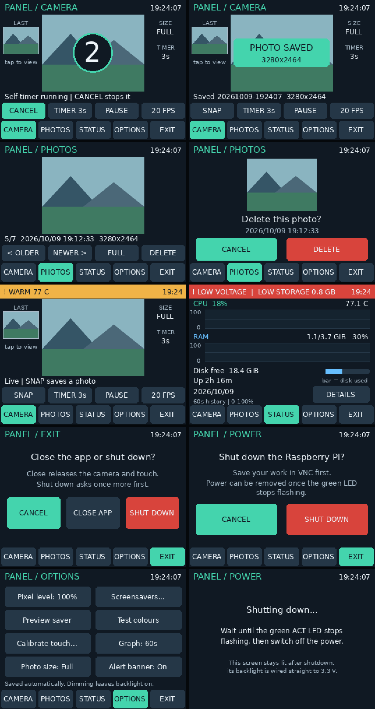

# Panel app: photos, self-timer, alerts, boot start and shutdown



*The preview uses illustrative scenery and sample readings, not your camera or live Pi data.*

## Install this update

1. Stop the running app with Ctrl+C in its Pi terminal and make a backup:

```bash
cp ~/panel_app.py ~/panel_app.previous.py
```

2. From Windows PowerShell, copy the app and the new boot-service installer (use the Pi's IP if `cyberdeck.local` doesn't resolve):

```powershell
scp panel_app.py setup_panel_service.py eli@cyberdeck.local:/home/eli/
```

3. Try it by hand first:

```bash
sudo python3 ~/panel_app.py
```

4. Once you're happy with it, have it start at boot (see "Start automatically at boot" below):

```bash
sudo python3 ~/setup_panel_service.py --now
```

No new packages, no reboot, and no change to SPI, colour order, GPIO or touch isolation. Photos, calibration and options in `~/cyberdeck-data/` are kept. Existing photos appear in the new Photos tab.

## What's new

The bottom bar now has five tabs: **CAMERA, PHOTOS, STATUS, OPTIONS, EXIT**.

### Full-resolution snapshots

- **SNAP** now captures a still at the sensor's full resolution (for example, 3280x2464 on a Camera Module v2 or 4608x2592 on a v3). The live preview stays at 320x240.
- While capturing, the preview freezes for about one to two seconds and shows *Capturing...* then *Saving...*. That's the camera switching modes and back again.
- If the full-resolution capture fails (for example, the camera can't allocate memory), the app restores the preview, saves the 320x240 frame instead, and says *(full-res failed)*. The reason is printed in the terminal or journal.
- When the preview is **paused**, SNAP saves the frozen frame you see (320x240), as before.
- **OPTIONS -> Photo size** switches between *Full* and *320x240* (instant, no preview interruption).
- Photos are written to a temporary file first, so a power cut can't leave a half-written JPEG in the gallery. SNAP refuses to save when less than 200 MB of storage is free.

### Self-timer and capture confirmation

- **TIMER** on the Camera page cycles **OFF -> 3s -> 10s**. The setting is saved.
- With a timer set, SNAP starts a large countdown over the preview. The SNAP button becomes **CANCEL** while the countdown runs. Leaving the Camera page also cancels it.
- Every saved photo gets a brief white flash, then a **PHOTO SAVED** box with the resolution. The *LAST* thumbnail on the left of the Camera page updates too.

### Photo review

- **PHOTOS** opens the newest photo. **< OLDER** and **NEWER >** browse the rest. The line under the image shows the position, date and time, and original resolution.
- Tap the image or **FULL** for a full-screen view, then tap anywhere to return.
- **DELETE** asks for confirmation before it removes the file. This can't be undone.
- On the Camera page, tap the **LAST** thumbnail to jump straight to the newest photo.
- Large JPEGs are decoded at reduced scale, so browsing stays quick even with 12 MP files.

### Health alert banner

A coloured bar replaces the page title on every page (and on the Radar/Starfield screensavers) when there's something to know. **Red** means critical; **amber** means warning:

| Alert | When |
| --- | --- |
| LOW VOLTAGE (red) | The firmware reports undervoltage right now |
| VOLTAGE DIPPED (amber) | An undervoltage happened between checks during this run (shown for 5 minutes) |
| HOT nn C (red) / WARM nn C (amber) | CPU temperature of at least 80 °C / at least 75 °C |
| THROTTLED / CPU CAPPED / TEMP LIMIT (amber) | The firmware is currently limiting the CPU |
| STORAGE nn MB (red) / LOW STORAGE (amber) | Less than 0.25 GB free / less than 1 GB free or 95% full |

Tap the banner to open the Status details page. **OPTIONS -> Alert banner: Off** hides it, for example while you knowingly run on a weak supply. An undervoltage flag that was already set before the app started doesn't trigger a banner; it still shows as *Past alerts* on the details page. The Black screensaver stays fully black.

### Start automatically at boot

`setup_panel_service.py` installs one systemd service, `cyberdeck-panel`, that runs `panel_app.py` as root at boot:

- **Crash -> automatic restart** after 5 seconds. A runaway crash loop gives up after 10 tries in 5 minutes.
- **CLOSE APP**, **Shut down**, and `sudo systemctl stop cyberdeck-panel` are deliberate exits and are *not* restarted.
- At boot, the app retries the camera three times before falling back to Status, in case the camera starts slowly.
- Photos and settings stay owned by your normal user, just as with `sudo`.
- The app now finds the ILI9341 framebuffer even if it isn't `/dev/fb0` (for example, if the boot order changes).

```bash
sudo python3 ~/setup_panel_service.py          # enable for next boot
sudo python3 ~/setup_panel_service.py --now    # enable and start now
sudo systemctl status cyberdeck-panel          # is it running?
journalctl -u cyberdeck-panel -f               # live log (replaces the terminal output)
sudo systemctl stop cyberdeck-panel            # stop it, e.g. to run by hand or recalibrate
sudo systemctl start cyberdeck-panel           # start it again
sudo python3 ~/setup_panel_service.py --undo   # remove boot start entirely
```

Only one copy can own the camera and touchscreen. While the service is running, starting `sudo python3 ~/panel_app.py` by hand stops with a message telling you to stop the service first. For `--calibrate`, stop the service, run the app by hand with `--calibrate`, then start the service again (or use **OPTIONS -> Calibrate touch**).

The installer only manages `/etc/systemd/system/cyberdeck-panel.service`. It refuses to overwrite a file with that name that it didn't create. Keep `panel_app.py` in a path without spaces (`/home/eli/` is fine). If you move it, re-run the installer.

### Safe shutdown

**EXIT** now offers **CANCEL**, **CLOSE APP** and **SHUT DOWN**. SHUT DOWN opens a second confirmation page; only its red **SHUT DOWN** button powers off the Pi. The app releases the camera and touchscreen, shows a *Shutting down...* screen and runs `systemctl poweroff`.

Because the backlight is wired straight to 3.3 V, the *Shutting down* message stays visible after the Pi has halted. **Wait until the green ACT LED stops flashing before you remove power.** If the shutdown command fails, the screen says so and the reason is printed. Under the boot service, the app then restarts by itself.

## Checks

The 20 automated tests pass (`python3 -m unittest discover -s tests -v`). They run without any Pi hardware. They cover options validation, alert levels and the undervoltage edge cases, finding a renumbered framebuffer, the photo library (save/list/preview/delete, ignoring broken files, refusing when storage is full), rendering every page with and without alerts, button hit areas, and the service installer (install, idempotence, undo, refusing foreign files).

Three tests run the real application loop with simulated screen, touch and camera:

1. SNAP at full resolution -> Photos -> Delete -> confirm -> Exit -> Shut down -> confirm. Checks the photo was captured and removed, and that poweroff was requested.
2. Set the timer to 3 s, SNAP, and wait. Checks that exactly one 320x240 photo was saved and the timer setting persisted.
3. Leaving the Camera page during a 10 s countdown cancels it.

**Still needs checking on the Pi:** full-resolution capture with your camera module, how long the preview freezes, colours of saved full-size photos, and boot start, crash restart and shutdown under systemd.

Suggested hardware check:

1. Take one photo at Full and one at 320x240, and confirm both look right in Photos and in VNC.
2. Try the 3 s timer.
3. Enable the service with `--now`, kill the process with `sudo pkill -f panel_app.py` and confirm it comes back within about 5 seconds.
4. Reboot and confirm the panel comes up on its own.
5. Use EXIT -> SHUT DOWN.
