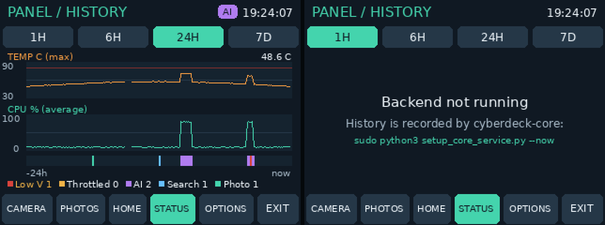

# cyberdeck-core: the local backend

`cyberdeck-core` is a small Python web service that runs beside the touch panel. Right now it
keeps a **telemetry log** (temperature, CPU, memory, undervoltage and throttling) and records
**activity** (photos taken, searches and AI answers), runs the [librarian](LIBRARIAN.md),
and reads a **GPS** receiver when one is set up. The ESP32 link from the
[roadmap](ROADMAP.md) will be added to it.

- **Local only:** it listens on `127.0.0.1:8765`, so only programs on the Pi can reach it.
- **Not root:** it runs as your normal user.
- **Light:** one sample every 5 seconds, written to the SD card once a minute.
- **Optional:** the panel works without it. STATUS -> HISTORY then says the backend isn't running.

## Install

On the Pi, in the repository folder:

```bash
cd ~/cyberdeck-repo && git pull
sudo apt install python3-flask
sudo python3 setup_core_service.py --now
curl http://127.0.0.1:8765/api/health
```

The last command should print `{"ok": true, ...}`. Then restart the panel so it picks up the
new code: `sudo systemctl restart cyberdeck-panel`.

| Task | Command |
| --- | --- |
| Status | `systemctl status cyberdeck-core` |
| Logs | `journalctl -u cyberdeck-core -f` |
| Restart after `git pull` | `sudo systemctl restart cyberdeck-core` |
| Turn on offline search | `sudo python3 setup_core_service.py --now --kiwix-url http://127.0.0.1:8080 --kiwix-book <book>` (see [LIBRARIAN.md](LIBRARIAN.md#backend-configuration)) |
| Remove | `sudo python3 setup_core_service.py --undo` |
| Run by hand instead | `python3 -m core` (Ctrl+C stops it and saves the buffer) |

If the installer says your user isn't in the `video` group, run the `usermod` command it
prints and log in again. Without that group, `vcgencmd` can't read the undervoltage flags.

## On the panel



- **STATUS -> HISTORY:**
  - **Charts:** maximum temperature (30-90 C, with a red line at 80 C, where the Pi starts to slow down) and average CPU use.
  - **Ranges:** **1H**, **6H**, **24H** and **7D**.
  - **Event strip** under the charts: red for undervoltage, yellow for throttling, purple for AI answers, blue for searches, green for photos.
  - **Counts** of each event along the bottom. Gaps in the lines mean the backend wasn't running.
- **AI badge:** a purple **AI** (or **SEARCH**) badge appears beside the clock while the backend is working on a question.
- **Turning it off:** start the panel with `--backend off` to disable the link entirely.

## What is recorded

Data lives in `~/cyberdeck-data/telemetry.sqlite3` and is kept for 7 days.

| Table | Contents |
| --- | --- |
| `samples` | Every 5 s: time, CPU %, temperature, memory %, free disk, load, CPU clock, raw `get_throttled` flags |
| `events` | `undervoltage`, `throttled` (from the flags), and activities: `ai`, `search`, `camera`, `other`, with start and end times |

**About undervoltage:** the firmware flags say whether undervoltage *happened*, not the
voltage. The log catches undervoltage that is happening at a sample, and the first dip since
boot even if it fell between samples (the sticky bit). Later short dips between samples can be
missed, because the sticky bit only clears at reboot. If the strip shows red during AI or
camera activity, the fix is the power supply (official 5.1 V 3 A, short cable), not software.

To look at the raw data: `sqlite3 ~/cyberdeck-data/telemetry.sqlite3 'SELECT * FROM events'`
(`sudo apt install sqlite3` for the command).

## GPS

The backend reads NMEA from one GPS source and serves the latest position at `/api/gps`.
With no source set there is no position: the backend never makes one up.

Choose the source with `--gps` when running by hand, or the `CYBERDECK_GPS` environment
variable:

| Value | Source |
| --- | --- |
| `serial:/dev/ttyACM0` | A receiver on USB or a serial port, read directly (9600 baud; add `:38400` for another rate). Your user needs to be in the `dialout` group |
| `gpsd` | [gpsd](https://gpsd.io) on this Pi (`gpsd:127.0.0.1:2947` by default); use this if gpsd already owns the port |
| `replay:/home/eli/track.nmea` | A recorded NMEA log, played in a loop at one fix per second. Every reading is marked **SIMULATED** |

Try it without hardware by replaying a log, then ask for the position:

```bash
cd ~/cyberdeck-repo && python3 -m core --port 8766 --gps replay:/home/eli/track.nmea
curl http://127.0.0.1:8766/api/gps
```

**Baud rate:** many receivers use 9600, but u-blox M10 modules (such as the BZ-251) often
ship at 38400 or 115200. If `/api/gps` says `no valid NMEA (wrong baud rate?)`, try
`serial:/dev/serial0:38400`, then `:115200`. On the Pi's GPIO UART (GPIO 14/15,
`/dev/serial0`) the serial console must be off and Bluetooth moved off that UART first;
a USB serial adapter such as a CP2102 shows up as `/dev/ttyUSB0` instead.

Only GGA and RMC sentences are used; lines with a bad checksum are dropped. A position older
than 10 seconds is no longer reported (the receiver sends one every second), and after an
error (unplugged receiver, gpsd stopped) the backend retries every 5 seconds. A bad
`--gps` value turns GPS off with a message instead of stopping the backend.

The systemd unit doesn't pass a GPS setting yet, and the panel's GNSS screen doesn't read
this yet; both are follow-up tasks.

## API

All responses are JSON. Times are Unix seconds.

| Method and path | Purpose |
| --- | --- |
| `GET /api/health` | `{"ok": true, "service", "version", "uptime_s"}` |
| `GET /api/telemetry/now` | Latest sample, active activities, `busy` kinds, open conditions, and banner-style `alerts` |
| `GET /api/telemetry/history?seconds=3600&points=240` | Samples averaged into at most `points` buckets: `[time, cpu, max temp, mem, undervoltage 0/1, throttled 0/1]`, plus `events`. `seconds` 60-604800, `points` 10-1000 |
| `POST /api/activity/start` `{"kind": "ai", "detail": "..."}` | Start an activity; returns `{"id": n}` |
| `POST /api/activity/end` `{"id": n}` | End it |
| `POST /api/activity/mark` `{"kind": "camera", "detail": "photo"}` | An instant event |
| `GET /api/gps` | `configured`, `source` (`serial`, `gpsd`, `replay` or null), `simulated`, `fix`, `lat`, `lon`, `altitude_m`, `satellites`, `hdop`, `speed_kmh`, `course_deg`, `utc` (receiver time from the last RMC with a fix), `age_s`, `error`; plus `"label": "SIMULATED"` for replays. Position fields are null without a current fix, and `utc` is null once the receiver has been silent for 10 s. Dead-reckoned, manual and receiver-simulator fixes count as no fix |

Librarian routes (`/api/search`, `/api/retrieve`, `/api/ask`, `/api/library/...`) are described
in [LIBRARIAN.md](LIBRARIAN.md#api); `deck ask "..."` is the terminal front end for `/api/ask`.

Activity kinds: `ai`, `search`, `camera`, `other`. Details are cut to 200 characters.

## For code inside the backend

Modules that run inside `cyberdeck-core` (the librarian in Phases 2-3) use the telemetry
object directly instead of HTTP:

```python
with telemetry.activity('search', query):
    results = kiwix.search(query)
with telemetry.activity('ai', question):
    answer = ollama.chat(...)
```

This makes the panel show the badge and puts the work on the HISTORY strip, so slow answers
and undervoltage can be compared.

## Code layout

| File | Contents |
| --- | --- |
| `core/sysinfo.py` | Readings shared with the panel: `/proc` and `/sys` sampler, throttle flag decoding, banner alerts |
| `core/telemetry.py` | Sampling, buffering, events, history buckets, SQLite store |
| `core/gps.py` | NMEA parser, serial, gpsd and replay sources, background reader |
| `core/server.py` | Flask routes (the only module that needs Flask) |
| `core/__main__.py` | `python3 -m core` entry point |
| `setup_core_service.py` | systemd installer |
| `panel_tools/backend.py` | The panel's background client |
