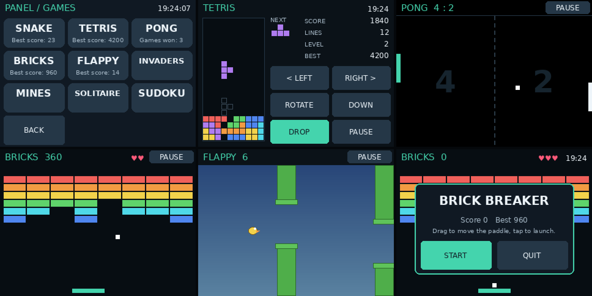
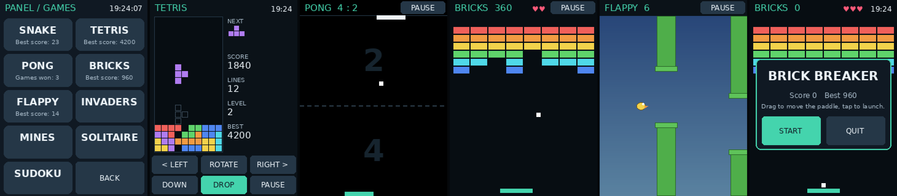
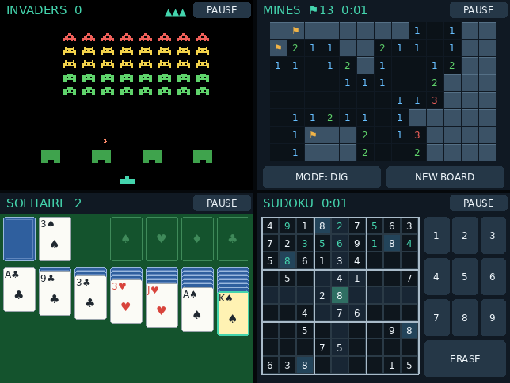
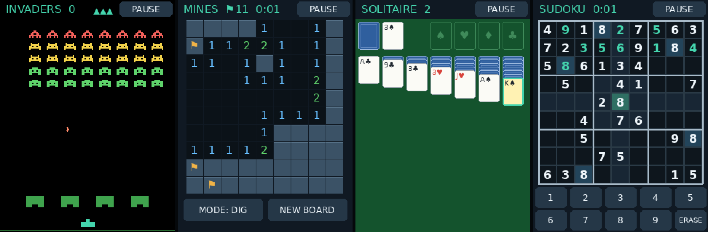

# Games

*The previews are drawn by the app's own code with sample game states.*

The Apps page's **GAMES** tile opens a menu of nine games: **Snake**, **Tetris**, **Pong**, **Bricks** (Brick Breaker), **Flappy**, **Invaders** (Space Invaders), **Mines** (Minesweeper), **Solitaire** and **Sudoku**. It's three columns in landscape and two in portrait. Each tile shows your record. **BACK** returns to Apps. Quitting a game returns to the Games menu.

All three games work in every screen rotation. While a game is running, the screensaver won't start.

## Tetris

The standard 10×20 board with all seven pieces. Pieces are dealt from a shuffled "bag" of seven, so you never wait long for a long bar.

| Control | What it does |
| --- | --- |
| **< LEFT / RIGHT >** | Move one column. Hold the button to keep sliding: repeats begin after about 0.3 s. |
| **ROTATE**, or tap the board | Rotate clockwise. Next to a wall or other blocks, it nudges the piece sideways when it can. |
| **DOWN** | Move down one row (+1 point). Hold it to keep going. |
| **DROP** | Drop straight to the bottom (+2 points per row). |
| **PAUSE** | Opens Resume / Quit. |

- **Ghost outline:** shows where the piece will land.
- **NEXT:** shows the piece coming after it.
- **Scoring:** clearing 1, 2, 3 or 4 lines scores 100, 300, 500 or 800 points, multiplied by the level.
- **Levels:** the level goes up every 10 lines, and pieces fall faster each level: 0.8 s per row at level 1, down to 0.1 s.
- **Game over:** when a new piece has no room to appear.
- **Layout:** in landscape the controls sit to the right of the board; in portrait they're in two rows underneath.
- **Paused games:** time spent paused, or with the app busy, never causes a burst of catch-up moves when you resume.

## Pong

You play against the computer, and the first to 7 points wins.

- **Moving your paddle:** keep a finger on the screen and drag. Your paddle follows it anywhere on the court. In landscape your paddle is on the **left**; in portrait it's at the **bottom**.
- **Angles:** where the ball hits your paddle decides its angle. The edges send it off steeply.
- **Speed:** the ball speeds up a little with every hit.
- **The computer:** it's beatable. Its paddle has a speed limit and aims slightly off, and it gets a little quicker each time it scores.
- **Serves:** after each point there's a short pause before the next serve.
- **PAUSE** is in the top right.

Dragging needed one small addition to the touch code: the app can now see where a finger is while it's still down. Before, it only learned about a tap when the finger lifted. Everything else still acts on release, as before.

## Brick Breaker

Clear the wall of 48 bricks with the ball. You have 3 lives (the hearts in the header).

- **Paddle:** drag a finger anywhere on the court and the paddle follows it. The paddle is at the bottom in every rotation.
- **Launch:** the ball waits on the paddle; tap the court to launch it, including after losing a life.
- **Angles:** where the ball hits the paddle decides its angle, as in Pong.
- **Speed:** the ball speeds up slightly with each paddle hit.
- **Scoring:** top rows are worth more (50, 40, 30, 20, 10, 10), multiplied by the level.
- **Levels:** clearing the wall starts the next level with a fresh wall and a faster ball.

## Flappy

Fly between the pipes, scoring a point for each one you pass. Hitting a pipe, the ground or the top ends the run.

- **Flap:** touch anywhere. It flaps the moment your finger touches the screen, not when you lift it, so it reacts immediately. Keeping your finger down doesn't keep flapping; touch again for the next flap.
- **Gap size:** the gap scales with the screen height, so it's a little roomier in portrait.

## Space Invaders

Five rows of eight aliens march side to side, stepping down each time they reach an edge.

- **Move:** drag a finger to move your cannon along the bottom.
- **Fire:** keep your finger down to keep firing. As in the original, only one shot can be in the air at a time.
- **Shields:** the four green bunkers soak up shots from both sides and wear away.
- **Speed:** the formation speeds up as you thin it out.
- **Scoring:** the top row is worth 30, the middle rows 20 and the bottom rows 10, multiplied by the wave.
- **Waves:** clearing one starts the next a little lower and faster.
- **Ending:** you have 3 lives (▲ in the header). The game ends when they run out, or when the aliens reach your row.

## Minesweeper

| Rotation | Board | Mines | Square size |
| --- | --- | --- | --- |
| Landscape | 13×8 | 16 | 22 px |
| Portrait | 9×10 | 14 | 24 px |

The squares are sized for a fingertip on the 2.8" screen. Your first tap is always safe: the mines are placed afterwards, away from it.

- **Tap** a square to dig it. Open areas spread out by themselves.
- **Press and hold** a square for about half a second to plant or remove a flag. Lifting your finger afterwards doesn't dig.
- **MODE: DIG / FLAG** switches taps to flagging, if you prefer that to holding.
- **Tap a number** whose mines are all flagged to open every other square around it.
- **NEW BOARD** starts over. The header shows mines left and the time.
- **Record:** your fastest clear.

Changing the screen rotation starts a fresh board, because the board shape changes.

## Solitaire

Klondike, drawing one card at a time from the stock, with unlimited passes.

- **Tap the stock** (top left) to turn a card. When it's empty, tap it to turn the waste pile back over.
- **To move:** tap a card to pick it up. It, and the cards on top of it, turn yellow. Then tap where it should go: a tableau pile (anywhere on or below it) or a foundation.
- **Tap the picked-up card again** to auto-move it: to a foundation if it fits there, otherwise to the first pile that takes it.
- **Usual rules:** build down in alternating colours. Only a King can go in an empty column. Face-down cards turn over automatically when they're uncovered.
- **Long piles** squeeze together so they always fit on the screen.
- **Record:** the fewest moves you've won in. The header shows the move count.

## Sudoku

Every puzzle is freshly generated with exactly one solution and 34 starting numbers. Generating one takes a fraction of a second.

- **Tap a square**, then a number. **ERASE** clears your entry; the starting numbers can't be changed.
- **Mistakes:** a wrong number turns red and adds to the ✗ count in the header.
- **Highlighting:** the selected square's row, column and box are highlighted, along with every square holding the same number.
- **Finished numbers:** a number's button dims once all nine of it are correctly placed.
- **Layout:** the keypad is a 3×3 grid beside the board in landscape and two rows underneath in portrait.
- **Record:** your fastest solve.

## Records

`~/cyberdeck-data/games.json` now holds:

- `snake_best`
- `tetris_best`
- `pong_wins`
- `bricks_best`
- `flappy_best`
- `invaders_best`
- `mines_best_seconds` (lowest wins)
- `solitaire_fewest_moves` (lowest wins)
- `sudoku_best_seconds` (lowest wins)

Saving one game's record keeps the others. Your existing Snake best score carries over.

## Checks

All 109 automated tests pass (`python3 -m unittest discover -s tests -v`), including 42 in `tests/test_games.py`:

- **Tetris rules:**
  - every piece has 4 cells in every rotation
  - the 7-bag deals each piece once
  - clearing lines scores correctly and the rows above drop down
  - 4-line clears and faster levels work
  - pieces stop at walls, and rotation nudges away from them
  - the game ends when a new piece can't appear
- **Tetris controls, in landscape and portrait:**
  - every button is on screen
  - a tap moves one column
  - holding repeats, and lifting the finger doesn't add an extra move
  - tapping the board rotates
  - the best score is saved only when it's beaten
  - a long gap doesn't cause catch-up moves
- **Pong rules:**
  - side-wall and paddle bounces
  - missed balls score
  - a fast ball can't pass through a paddle
  - first to 7 ends the game
  - the computer's speed limit
  - the paddle stays inside the court
- **Pong controls:**
  - dragging puts your paddle under your finger in both orientations
  - the header is ignored for dragging
  - wins are saved
  - pausing works
  - the court resizes after a screen rotation
- **Brick Breaker rules:**
  - the ball rides on the paddle until launched
  - hitting a brick removes it, scores, and bounces the ball back
  - the paddle returns the ball
  - a missed ball costs a life, and three misses end the game
  - clearing the wall starts a faster level with a full wall
- **Flappy rules:**
  - gravity and flapping
  - a point for each pipe passed
  - crashes into pipes and the ground
  - pipes keep coming, with the gap always fully on screen
- **Brick Breaker and Flappy controls, in landscape and portrait:**
  - the paddle follows a drag
  - a tap launches the ball
  - Flappy flaps on press, ignores the release, and doesn't flap on PAUSE
  - records are saved
- **Space Invaders:**
  - one shot at a time, and hits score by row
  - the formation marches, steps down and speeds up
  - bombs wear down shields and cost lives
  - clearing a wave starts the next; aliens reaching your row ends the game
  - dragging moves and fires; the record is saved
- **Minesweeper:**
  - the first dig is safe across 20 random boards, and open areas spread
  - flags block digging
  - tapping a number with a wrong flag correctly sets off the mine
  - a cleared board is a win
  - tap digs and press-and-hold flags, with no extra dig on release
  - the board and toolbar fit, with squares at least 22 px
  - the best time is kept
- **Solitaire:**
  - the deal is correct
  - alternating colours, only Kings into empty columns, uncovered cards flip, aces go up
  - the stock turns back over
  - double-tapping auto-moves a card
  - a 19-card pile still fits the screen in both orientations
  - tap-to-move works in both orientations
- **Sudoku:**
  - generated puzzles always have one solution and valid rows, columns and boxes
  - starting numbers are locked
  - mistakes are counted, and erasing works
  - completing the board wins, with the best time kept
  - the keypad and board fit in both orientations
- **Games menu:** all nine games and BACK lead to the right place in both orientations.
- **Real application loop** with a simulated screen, touch and camera:
  1. Apps → Games → Tetris → Start → Drop → Pause → Quit
  2. Pong → Start → Pause → Quit
  3. Bricks → Start → launch → Pause → Quit
  4. Flappy → Start → Pause → Quit
  5. Every game in the menu, including the four new ones: Start → Pause → Quit
  6. Back → Exit
- **Updated Snake test:** the end-to-end Snake test now goes through the Games menu.

**Still needs checking on the Pi:**

- how responsive Tetris's buttons and hold-to-repeat feel on the resistive screen
- how smoothly Pong's paddle tracks your finger
- whether the computer opponent is fun to play against: easy to adjust if it's too easy or too hard
- whether Flappy's flap and gravity feel right on the 2.8" screen: easy to tune
- whether Minesweeper's half-second press-and-hold suits you
- whether Solitaire's cards are readable in portrait, where they're about 29 px wide
