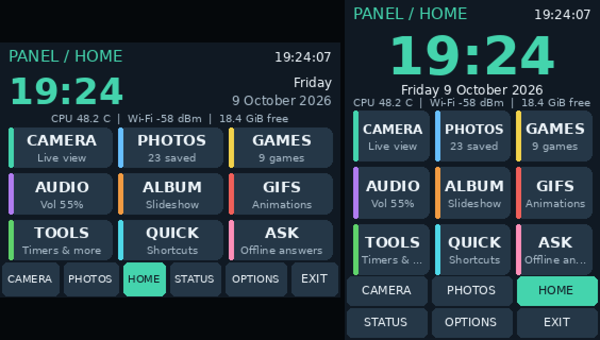

# Home page and starting at boot



## Home page

The app now opens on **Home**, a launcher for everything else.

- **Clock and date** at the top.
- **Status line:** CPU temperature, Wi-Fi signal and free storage. The health banner still takes over the top bar when something needs attention.
- **Nine tiles**, each with a short live note:

  | Tile | Opens | Note shown |
  | --- | --- | --- |
  | Camera | The camera | Whether it's live or connecting |
  | Photos | Your photos | Number saved |
  | Games | The Games menu | Number of games |
  | Audio | Volume and visualizer | Current volume |
  | Album | Slideshow | |
  | GIFs | GIF player | |
  | Tools | Tools menu | |
  | Quick | Quick controls | |
  | Ask | Ask the offline librarian ([LIBRARIAN.md](LIBRARIAN.md#on-the-panel)) | Answering..., or Backend off |

- **Screensaver:** the Saver tile made way for Ask. The saver still starts on its own after the idle delay, and **OPTIONS → Screensavers → PREVIEW** starts it at once.
- **Tab bar:** the **APPS** tab is now **HOME**, in the same spot, so the other tabs haven't moved. In portrait, HOME is the top-right tab.
- **Returning:** leaving the Games menu, Tools, Audio and the other apps now brings you back to Home.
- **Power:** opening on Home instead of the live camera means the camera sensor rests until you open Camera. It stops 15 s after you leave the Camera page.

To open on the Camera page instead, set `"start_page": "camera"` in `~/cyberdeck-data/options.json` while the app is stopped.

## Make the app start at boot

The app ships with a systemd service that starts it when the Pi powers on and restarts it automatically if it ever crashes. There are two ways to turn it on.

### From the panel

**OPTIONS → Start at boot: Off** (in portrait it reads **Boot: Off**). Tap it to switch to **On**.

- **Install:** the first time, this writes and enables the `cyberdeck-panel` service for this copy of the app and your data folder.
- **Needs sudo:** the app must have been started with `sudo`, which it always is.
- **Takes effect next boot:** the switch never starts or stops the copy that's running now. Close any copy you started by hand before rebooting, or you'll have two.
- **Turning it off** disables the service for future boots but leaves the running app alone.

### From a terminal

Equivalent to the panel switch, and it also starts it now:

```bash
cd ~/cyberdeck-repo
sudo python3 setup_panel_service.py --now
```

Useful commands:

| Command | What it does |
| --- | --- |
| `systemctl status cyberdeck-panel` | Is it running? |
| `journalctl -u cyberdeck-panel -f` | Live log: messages and errors |
| `sudo systemctl stop cyberdeck-panel` | Stop it, e.g. to run it by hand |
| `sudo systemctl start cyberdeck-panel` | Start it again |
| `sudo python3 setup_panel_service.py --undo` | Remove start-at-boot completely |

How it behaves:

- **Starts without a login:** it starts at boot whether or not anyone logs in.
- **Audio needs the desktop:** the audio controls need your desktop session, which Raspberry Pi OS's auto-login provides.
- **Crashes:** it restarts 5 seconds after a crash. **CLOSE APP** and **SHUT DOWN** are deliberate and don't trigger a restart.
- **Only one copy at a time:** while the service is running, `sudo python3 panel_app.py` will tell you to stop the service first.
- **Updates:** the service runs the code in your checkout, so updating with `git pull` or **Tools → Updates** and then restarting the service (or tapping Restart app) loads the new version.

## Checks

All 116 automated tests pass, including 7 new ones in `tests/test_home.py`:

- **Home tiles:** all nine fit on screen and lead to the right places in both orientations, and the HOME tab sits where APPS was.
- **Boot status:** the switch reads systemd's enabled, disabled and unavailable states correctly.
- **Turning boot start on:** writes the service with your data folder and enables it, without starting a second copy.
- **Turning it off:** only disables the service.
- **Without root:** both ask for sudo.
- **Real application loop:** the app opens on Home; the Games tile leads to the Games menu, BACK returns to Home, and the Camera tile opens the camera.
