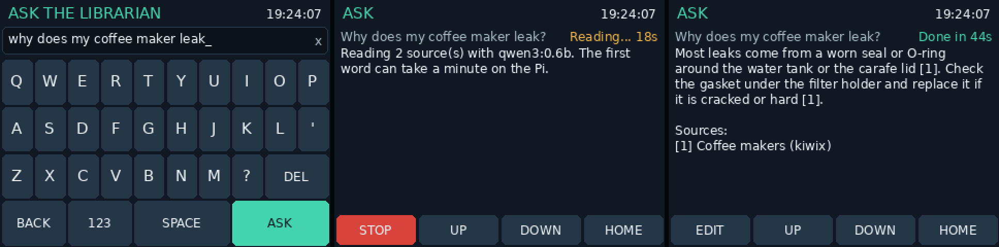

# Offline librarian

Phase 2 retrieves text without calling a model. Its modules use the standard library;
the backend uses the already-approved Flask package. It never falls back to the internet.

## Kiwix setup

Eli reports kiwix-tools 3.7.0 / libkiwix 14.0.0; see [PI-BASELINE.md](PI-BASELINE.md).
Its real recorded XML confirms `books.name`, RSS output, port 8080 and book key
`restarters_en_all_maxi_2026-04` for the foreground test. No Wikipedia archive is
confirmed yet. Use these settings for Restarters; change the book key when adding Wikipedia.

Start the confirmed archive in a terminal on the Pi (leave it open):

```bash
kiwix-serve --address=127.0.0.1 --port=8080 /home/eli/kiwix/zims/restarters_en_all_maxi_2026-04.zim
```

This is a foreground process, not a boot service. If port 8080 is already occupied,
use the existing Kiwix instance or choose a free port and update the client base URL.

`KiwixClient(base_url, opener=None, book='', book_parameter='books.name', timeout=2.0)`
uses `/search?pattern=...&format=xml&pageLength=...`. Set `book_parameter='content'`
for versions that require the legacy parameter. The base URL must be loopback HTTP
(for example `http://127.0.0.1:8080` if that is your configured port). A URL prefix
is supported. An empty book searches all books supported by that server.

kiwix-serve only returns articles that contain every search word, so one word the wiki
doesn't use (for example "flickers" in "My table lamp flickers. What should I check?") would
find nothing. It also reads `OR` as an ordinary word, so an any-word search isn't possible.
When the all-words search returns fewer than five articles, the librarian searches again with
adjacent word pairs (`table lamp`, `lamp flickers`, ...) and then single words, stopping once
it has five; passage ranking then drops articles that don't cover enough of the question.
The pair searches all run and take their results in turns (each pair's best article, then
each one's second, ...), so a broad first pair such as `test fuse` can't fill all five slots
before `fuse plug` is tried.
Translated copies of a wiki page (`Table lamps/fr`) are skipped so they don't use up the
five slots; `/en` copies count as the page itself. Main Page is skipped in every language:
it links to everything, so it matched many searches without answering any.

Search results contain `title`, `url`, `snippet`, and `source`. Article URLs come
directly from the RSS response, preserving `/content/<book>/...` or `/<book>/A/...`
paths rather than guessing a layout. Cross-origin links and redirects are refused.
HTTP proxies are disabled. Each HTTP operation has a two-second socket timeout and
a two-megabyte response cap; search returns at most 20 results. A failed server raises
a readable `KiwixError`. Callers should display that error.

`fetch_article(client, url)` returns plain paragraphs using `html.parser`, dropping
navigation, tables, references and other common Wikipedia page furniture, and paragraphs
that are at least 80% link text (lists of links to other pages). The parser does not
execute scripts or load linked assets. Before ranking, each run of article paragraphs shorter
than 200 characters is joined onto the next: on the Pi, one-line list items such as
"Filter coffee makers" were mostly title words, so they outscored the paragraphs that
explain something and took the model's sources.

## Known limits and Pi check

See [LIBRARIAN-RANKING.md](LIBRARIAN-RANKING.md) for keyword rules, BM25 scoring and
the configurable relevance gate.

Recorded XML and article HTML verify the installed search format and extraction; other
compatibility fixtures are synthetic.

To check the running service live, start kiwix-serve as above, install the service with
the `--kiwix-*` options from **Backend configuration**, then:

```bash
curl 'http://127.0.0.1:8765/api/search?q=repair'
```

Results with `"source": "kiwix"` and `/content/restarters_en_all_maxi_2026-04/...` URLs mean
the service reached Kiwix. With a Wikipedia ZIM installed (and `--kiwix-book` set to its
key), search for `passive sonobuoy`, verify that the result URL opens offline, then check that fetched paragraphs describe hydrophones and
radio transmission. Stop kiwix-serve and confirm a clear error instead of a hang.

Unusual HTML may need additional cleanup rules. Table-only facts and reference sections
are intentionally excluded. UTF-8 articles are assumed. A socket timeout bounds stalled
I/O, not a hostile server that continuously trickles bytes; the trusted loopback service
is the only allowed HTTP destination.

## Local documents

Create `~/cyberdeck-data/library/` and copy UTF-8 `.txt`, `.md`, `.html` or `.htm` files
there (subfolders are supported). PDF indexing is deferred. Then, from the repository:

```bash
python3 -m core.librarian.library
```

Run that command again after adding, changing or removing files. It compares nanosecond
mtime and size; unchanged documents are not read or rewritten. Deleted, unreadable,
oversized or unsupported documents are removed from the index. Keep timestamps accurate:
an edit preserving both size and mtime cannot be detected. The command prints changed /
removed counts and skipped-file warnings. HTML uses the same paragraph cleanup as Kiwix;
Markdown is searchable plain text, without rendering.

The SQLite FTS5 database defaults to `~/cyberdeck-data/library.sqlite3`, outside the
document folder. Indexing batches changes in one transaction. Searches use read-only,
short-lived connections, and never reindex automatically. A missing index is an empty
local library. A corrupt or locked index yields a clear error. No vector database is used.

Limits: two megabytes per file and the first 1,000 chunks per document; symlinks and hidden
files/directories are skipped. Local retrieval considers at most 80 matching chunks.
Rerun indexing after removing a large amount of data; SQLite may retain freed pages for
reuse rather than shrink the database. Library files and the index are user data: do not commit them.

## Backend configuration

With Kiwix running as above, start the backend in a second terminal from the repository:

```bash
export CYBERDECK_KIWIX_URL=http://127.0.0.1:8080
export CYBERDECK_KIWIX_BOOK=restarters_en_all_maxi_2026-04
python3 -m core
```

Exports in your terminal do not reach the `cyberdeck-core` boot service. Give the service
the Kiwix settings through its installer instead, which writes them into the unit and
restarts it:

```bash
sudo python3 setup_core_service.py --now \
  --kiwix-url http://127.0.0.1:8080 --kiwix-book restarters_en_all_maxi_2026-04
```

The installer refuses a non-loopback URL or values with spaces or quotes. Re-running it
without the `--kiwix-*` options (for example after `git pull`) keeps the saved settings;
`--no-kiwix` removes them. Add `--kiwix-book-parameter content` only for a legacy Kiwix.
Check what the service has with `systemctl show cyberdeck-core -p Environment`.

The backend reads these environment variables (the installer sets the Kiwix ones):

| Variable | Meaning |
| --- | --- |
| `CYBERDECK_KIWIX_URL` | Actual loopback HTTP base URL, including port; unset disables Kiwix |
| `CYBERDECK_KIWIX_BOOK` | Book key from a working Kiwix article URL; empty searches all available books |
| `CYBERDECK_KIWIX_BOOK_PARAMETER` | `books.name` for installed libkiwix 14.0.0; legacy `content` is optional |
| `CYBERDECK_LIBRARY_DIR` | Override document folder (default `~/cyberdeck-data/library`) |
| `CYBERDECK_LIBRARY_DB` | Override index path (default `library.sqlite3` beside the document folder) |

The reindex command uses the same library environment variables, or `--root` and `--db`.
If the backend runs with a custom `--data` directory, set these two library variables
explicitly; the librarian does not infer that argument and the installer does not set them.

## API

Both routes accept `q` (1–1,000 characters):

- `GET /api/search?q=passive%20sonobuoy` returns document hits with title, offline URL,
  snippet and source. It uses keywords, Kiwix full-text search and local FTS5.
- `GET /api/retrieve?q=How%20does%20a%20passive%20sonobuoy%20work%3F&budget_tokens=1400`
  returns ranked passages. Budget is optional, 0–10,000. Each result has `text`, `title`,
  `url`, `source` (`kiwix` or `local`) and `score`.

Successful responses contain `query`, `keywords`, `results`, `warnings` and `partial`.
No evidence returns `results: []`. If one source fails but another provides results,
the response includes warnings and `partial: true`. If no results can be returned after
a source failure, HTTP 503 carries `error`; this must not be treated as evidence that
the answer is absent. Invalid input is HTTP 400. Only one API search runs at a time;
another receives a readable 503 rather than increasing Pi memory pressure.

`GET /api/ask?q=How%20does%20a%20passive%20sonobuoy%20work%3F` answers from the offline
sources (see **Grounded answers**). It returns `question`, `answer`, `found`, `uncited`,
`cited`, `dropped`, numbered `sources` (`n`, `title`, `url`, `source`, `score`, `text`),
`warnings`, `partial`, `model`, `seconds` and `output_tokens`. "Not found" is a normal
answer with `found: false` and `model: null` (the model wasn't called). Add `stream=1` for
newline-delimited JSON: one `passages` event (with `keywords` and `model`), `text` events as
the answer streams (raw: citations are checked only in `done`, so a client showing `text`
should drop numbers above the passage count, as `deck ask` does), then `done` with the fields
above, or `error`. A source or model failure
is HTTP 503 with `error` (or an `error` event when streaming), never a false "not found".
One question is answered at a time; another gets a 503 until it finishes. Closing the
connection stops the model.

Local URLs use `GET /api/library/<relative-path>` and return the original document as
plain text with browser execution blocked. Paths outside the configured library and
symlinks are rejected. Kiwix URLs retain the server's exact article path and configured
loopback origin. Open links on the Pi, where those services run.

## Phase 3 interface

```python
from core.librarian import retrieve
passages = retrieve(question, budget_tokens=1400, telemetry=telemetry)
```

`retrieve` returns `list[Passage]`. `telemetry` is optional. For explicit configuration
or test injection, use `Retriever(kiwix=client, library=library, telemetry=telemetry)`
from `core.librarian.service`. Set `threshold` on that constructor to tune the gate.
Each retrieval/search is wrapped in `telemetry.activity('search', question)` when supplied.
Leave the nested Kiwix client's telemetry unset when the Retriever owns the activity.

An empty list means Phase 3 should answer "not found in the offline sources" without
calling a model. `RetrievalError` means a source failed; display the error instead.
Use `Retriever.run()` when the caller needs warnings about partial results as well.
Nothing here invokes Ollama. Context token estimates cover passage text only.

## Ollama client

`core/librarian/ollama.py` talks to the local Ollama server's `/api/chat`. It is the
model step for Phase 3; nothing calls it automatically yet. Check it on the Pi from the
repository (Ollama must be running and `qwen3:0.6b` pulled):

```bash
python3 -m core.librarian.ollama "Say hello in five words"
```

The answer streams to the terminal, then a line with the model, token count, time and
stop reason. Without Ollama it prints a readable error instead of a traceback; a missing
model names the `ollama pull` command to run.

```python
from core.librarian.ollama import OllamaClient, OllamaError
client = OllamaClient.from_environment(telemetry)
for piece in client.stream([{'role': 'user', 'content': prompt}]):
    ...                      # or: reply = client.chat(messages, on_text=print)
```

Requests use `stream: true` and `think: false`. Any `<think>...</think>` text an older
Ollama still produces is removed before it is shown, and a separate `thinking` field is
ignored. Every request runs inside `telemetry.activity('ai', detail)` when telemetry is
given, so the panel's AI badge lights while the model works. The URL must be loopback
HTTP, and proxies are disabled. Each socket read may wait up to 120 s (the first word on
the Pi can be slow while the model loads), and a reply is capped at one megabyte.
Failures raise `OllamaError`: server down, timeout, missing model, a dropped or truncated
stream, or an error reported mid-answer. Ollama sends nothing until the model has read
the whole prompt, so a timeout before the first word is reported as "did not start
answering" rather than as Ollama being down.

| Variable | Default | Meaning |
| --- | --- | --- |
| `CYBERDECK_OLLAMA_URL` | `http://127.0.0.1:11434` | Loopback HTTP address of Ollama |
| `CYBERDECK_OLLAMA_MODEL` | `qwen3:0.6b` | Model name from `ollama list` |
| `CYBERDECK_OLLAMA_NUM_CTX` | `2048` | Context size in tokens (256-32768); larger is slower and uses more RAM |
| `CYBERDECK_OLLAMA_NUM_PREDICT` | `400` | Maximum answer length in tokens (1-4096) |
| `CYBERDECK_LIBRARIAN_BUDGET` | `400` | Passage tokens the model reads before answering (100-10000, capped to fit the context). On the Pi most of the wait for the first word is reading these, so a smaller budget answers sooner with less detail. The `cyberdeck-core` service doesn't see a value set in a terminal, so it applies to `deck ask --local` and `deck bench`, not to `deck ask` through the running backend |

The defaults match the Pi, so the boot service needs no extra settings.

## Asking questions

With Kiwix, Ollama and the `cyberdeck-core` service running, ask from any terminal on the Pi:

```bash
~/cyberdeck-repo/deck ask "How does a passive sonobuoy work?"
```

To type just `deck`, link it once (no sudo; open a new terminal afterwards):
`mkdir -p ~/.local/bin && ln -s ~/cyberdeck-repo/deck ~/.local/bin/deck`.

`deck ask` sends the question to the backend's `/api/ask`, so the panel's AI badge lights and
only one question is answered at a time. It prints `Searching...`, then `Reading N passage(s)
with qwen3:0.6b...` while the model reads (the slow part on the Pi), then streams the answer
and the cited sources. Citations to sources the model wasn't given are left out as the text
streams, not only in the final check. Ctrl+C stops it cleanly, and stops the model too. If the backend isn't
running, or predates `/api/ask`, it says so and answers in the terminal itself. `--local`
always answers in the terminal; `--explain` adds the keywords and passage scores (with
`--local`, also the Kiwix articles found).

### On the panel



**HOME → ASK** asks the same backend from the touchscreen, so `cyberdeck-core` must be running.

- **Typing:** type on the on-screen keyboard; **123** switches to digits and symbols. Tap the
  x at the right of the question box to clear it. When the box is empty, tapping it lists your last three questions
  and a few example questions; tap one to ask it.
- **Waiting:** the answer page shows the time so far: *Searching*, then *Reading* while the
  model reads the sources (this can take a minute on the Pi), then *Answering* as the text
  streams in.
- **Stopping:** **STOP** ends the question at once. The model stops when it next writes, so
  stopped while it is still reading, it finishes reading first and a new question waits that long.
- **Answers:** the answer keeps its [n] citations and ends with the cited sources. *Not found
  in the offline sources*, *UNVERIFIED* (no citations) and *QUOTED* (the sources pasted back
  instead of an answer) are shown as they are, never hidden.
- **Scrolling:** **UP** and **DOWN** scroll a long answer.
- **Editing:** **EDIT** brings the question back to change it.
- **Leaving:** **HOME** leaves while the answer carries on in the background; the Ask tile reads
  *Answering...* until it finishes. The screensaver waits while the ASK page is open and answering.
- **Backend down:** if the backend isn't running, the page says so instead of answering. It
  never answers on the panel itself.

## Benchmark

`deck bench` asks a list of questions and reports what matters for the librarian: did the
right article reach the top 3 passages, did it admit "not found" for questions the sources
can't answer, and how long it took on the Pi.

```bash
~/cyberdeck-repo/deck bench --no-model   # retrieval only: quick, checks the question list
~/cyberdeck-repo/deck bench --json ~/cyberdeck-data/bench.json   # full run with the model
~/cyberdeck-repo/deck bench --budget 700 --json ~/cyberdeck-data/bench-700.json   # fewer passages
```

`--budget` sets how many passage tokens the model reads, to compare speed against answer
quality. The summary's largest prompt is the model's own token count; if it exceeds the
context size (2,048 by default) the start of the prompt was cut, so lower the budget; `--limit 5` runs only the first five questions.

Each line shows the verdict, time to first word and total time, for a miss the titles
it got instead, and for a copied answer or an answered out-of-scope question what the model
said. `--json` keeps every answer. The summary gives the **top-3 hit rate** (in-scope questions whose expected
article was among the first three distinct passage titles), how many in-scope questions were
answered and how many of those cited nothing or were **copied** (at least 60% of the answer's
words pasted from the sources in runs of eight or more, which reads as the sources rather
than an answer; marked COPIED on its line), the **honest "not found" rate** for
out-of-scope questions, median and maximum retrieval, first-word and total times, and memory:
the lowest `MemAvailable` and the peak resident memory of Ollama and its `llama-server`
model runner, sampled every half second from `/proc`. The full run takes a while (about a minute per
answered question on the Pi); run it with nothing else busy, and Ctrl+C stops it.

Questions live in `core/librarian/benchmarks/restarters.json` as
`{"q": "...", "expect": ["title text"]}`; a passage title matches when it contains an
`expect` entry as whole words (a plural `s` or `es` is allowed), ignoring case and accents,
so `Lamp` matches `Table lamps` but not `Clamp meter`. An empty `expect` marks a question
the sources shouldn't answer. Most of those find no passages and never reach the model; the
ones about repair topics (a part number, a screw torque) are meant to find related
passages that lack the specific fact, so they test whether the model says it
doesn't know. On the Pi, the torque and toaster questions do find passages; the coffee
maker and kettle part-number questions don't (too few of their words appear together to
pass the relevance gate), so they end as an honest "not found" without testing the model. Entries with `"checked": true` use titles seen on the Pi; the other
in-scope titles are guesses at Restarters wiki pages, so run `--no-model` first and fix any
`expect` that names an article your ZIM doesn't have. Pass another file as the first
argument for a different ZIM (for example a Wikipedia set).

### Baseline

First full run on the Pi 4 (4 GB) with the Restarters ZIM, `qwen3:0.6b`, the default
2,048-token context and 1,400-token passage budget, 11 October 2026:

| Measure | Result |
| --- | --- |
| Top-3 hit rate | 75% (12 of 16 in-scope questions) |
| Answered (in scope) | 94% (15 of 16; the other timed out), none uncited |
| Honest "not found" | 100% (4 of 4 out-of-scope questions) |
| Retrieval | 0.22 s median, 1.28 s max |
| Time to first word | 69 s median, 111 s max |
| Total per question | 79 s median, 237 s max |
| Lowest available memory | 339 MiB |

Retrieval and honesty are good; speed is the problem. Most of the wait is the model reading
the passages before its first word, and one question hit the 120-second Ollama timeout
before any text arrived. Ollama's peak memory read 35 MiB because the model runs in a
separate `llama-server` process the benchmark didn't count (fixed since); `ps` showed that
process at about 800 MiB. Chromium was also open on the Kiwix page during the run, using
roughly 800 MiB more, which explains most of the low available memory. Remaining misses: hair dryer and cracked phone
screen (no matching article found in the ZIM), fuse (Glossary:Fuse not reached) and
multimeter (expected article ranked 4th).

Later runs the same day with Chromium closed and smaller passage budgets
(`deck bench --budget 700`, then `--budget 400`, which became the default):

| Measure | 1,400 tokens | 700 tokens | 400 tokens | 400, one source per article | 400, own-words prompt |
| --- | --- | --- | --- | --- | --- |
| Top-3 hit rate | 75% | 75% | 75% | 75% | 75% |
| Answered (in scope) | 94% | 100%, none uncited | 100%, none uncited | 100%, 12% uncited | 100%, none uncited, 31% copied |
| Honest "not found" | 100% | 100% | 100% | 100% | 75% (6 of 8; 2 new questions answered) |
| Time to first word | 69 s median, 111 s max | 45 s median, 56 s max | 28 s median, 55 s max | 22 s median, 31 s max | 24 s median, 32 s max |
| Total per question | 79 s median, 237 s max | 62 s median, 163 s max | 45 s median, 94 s max | 35 s median, 65 s max | 37 s median, 61 s max |
| Largest prompt | not measured | 835 tokens | not recorded | 502 tokens | 559 tokens |
| Lowest available memory | 339 MiB (Chromium open) | 1,130 MiB | 973 MiB | 1,126 MiB | 946 MiB |

Smaller budgets cut the wait for the first word with no loss in hits or answers. The 400 run
overlapped one manual `deck ask`, so its slowest times are a little high. The model reads
roughly 18 prompt tokens a second on the Pi, so most of the wait is still that reading.

The last column is after merging paragraphs into one source per article
([#28](https://github.com/elijahjtan1/cyberdeck/pull/28)): fewer, shorter prompts sped up the
first word, but two answers (iPhone, table lamp) cited nothing, and the coffee maker answer
was its three sources pasted back in the `[1] Title` form the prompt showed them in. The
prompt now labels them `Source [1]: Title` and ends with the instruction to answer in a few
sentences of the model's own words with citations, and the benchmark counts copied answers.
After the next run, all five copied answers still began "[1] <source text> [2] ...", the
bracket-first layout of the source labels, so the labels became `Source 1: Title`.

The own-words prompt
([#40](https://github.com/elijahjtan1/cyberdeck/pull/40)) left no answer uncited. The copied
measure is new, so 31% has no earlier figure to compare with. That run was also the first with
the four part-number and torque questions from
[#29](https://github.com/elijahjtan1/cyberdeck/pull/29), and two of them (toaster heating
element, iPhone 12 screw torque) were answered instead of "not found". The benchmark now
prints what the model said for those.

**Expectations changed after these runs.** Hair dryer, fuse and cracked phone screen named
articles that the Restarters wiki doesn't have. A retrieval trace on the Pi showed their
content in other pages, so `Cleaning`, `PAT testing` and `Spare parts` became expected titles
([#41](https://github.com/elijahjtan1/cyberdeck/pull/41)). That alone turns those three
misses into hits, so a run after it reports a higher top-3 rate without better retrieval.
To compare with the 75% above, also count the hits under the old expectations: those three
questions counted as misses then, so subtract any of them that hit only through a new title.

## Grounded answers

`core/librarian/answer.py` puts retrieval and the model together. To test it without the
backend, run it in the terminal directly:

```bash
python3 -m core.librarian.answer "How does a passive sonobuoy work?"
```

That is the same as `deck ask --local`. If `CYBERDECK_KIWIX_URL` isn't set in your terminal, the command uses the Kiwix settings
the `cyberdeck-core` service was installed with (and says so); if neither has them it warns
that Kiwix is off, so only local documents are searched. Add `--explain` to see each step:
the keywords sent to Kiwix, the articles Kiwix returned, and the passages that passed the
relevance gate with their scores. That tells apart a ZIM without the topic (no articles),
keywords that miss (articles but no passages), and a model problem (passages but a poor answer).

The answer streams, followed by the numbered sources it was given. When retrieval finds
no passage above the relevance gate, it prints `Not found in the offline sources.` at once
and never calls the model. Passages from the same article are joined into one source, best
article first and its paragraphs in page order, so a page that supplied eleven paragraphs is
one `[1]` rather than eleven numbers (with eleven, the small model tended to describe its
sources instead of answering). The sources go to the model numbered `[1]`, `[2]`, ... with
their titles, under instructions to answer only from them, cite source numbers, and reply
with that exact not-found sentence when the sources don't contain the answer. If the model
does so, the result is reported as not found too, even when it wraps the sentence in quotes
or bold or adds a citation like `[1]`. Text after the sentence makes it an answer only if
that text cites a source. A reply that only says in its own words that the sources lack the
answer ("The part number is not provided in the sources.", "The sources do not provide
information about ...") is not found as well, but only when every sentence is about the
sources lacking the answer and has no second clause (a comma, `;`, brackets, a dash, `so`, `if`, `but`, `and`,
`which`, `usually`, `use`, `check` ...). A leading "Therefore," or "Unfortunately," doesn't count. Anything that might carry advice keeps the reply an answer, since hiding a real answer
is worse than showing an honest one as unverified. A reply whose first sentence has a
citation where the value should be ("The thermal fuse in a Philips HD7546 is [1].") is not
found too: the model had nothing to put there.

```python
from core.librarian.answer import answer
result = answer(question, retriever, client, on_text=print)
result.found, result.text, result.sources   # source [n] is result.sources[n - 1]
```

The passage budget is shrunk so passages, about 250 tokens of instructions and the answer
all fit in the model's context: with the defaults (2,048 context, 400 answer tokens) that
is 1,398 passage tokens. A failed source or model raises `RetrievalError` or `OllamaError`
rather than returning "not found", because an outage is not evidence that the answer is
absent. `ask_events()` yields the same steps one at a time (passages, text pieces, then the
`Answer`) for callers that stream, such as `/api/ask`.

### Citation check

After the model finishes, `[n]` and `[n, m]` citations are checked against the sources it
was given. A number with no matching source (for example `[5]` when there were three) is
removed from `result.text` and listed in `result.dropped`; the valid ones are in
`result.cited`, in order of first use. A found answer with no valid citation has
`result.uncited` set and must be shown as unverified. The command prints
`UNVERIFIED: the answer cites no source.` and lists every searched passage instead of
the cited ones. When at least 60% of a found answer's words are runs of eight or more words
copied from the sources, `result.copied` is set and the command prints
`QUOTED: this repeats the sources instead of answering.` The text is still real source text
with its citations, so it is shown rather than hidden.

The check is by number only: it proves each citation points at a real passage, not that
the passage supports the sentence. Text already streamed through `on_text` is the raw model
output; show `result.text` once the answer is complete.
