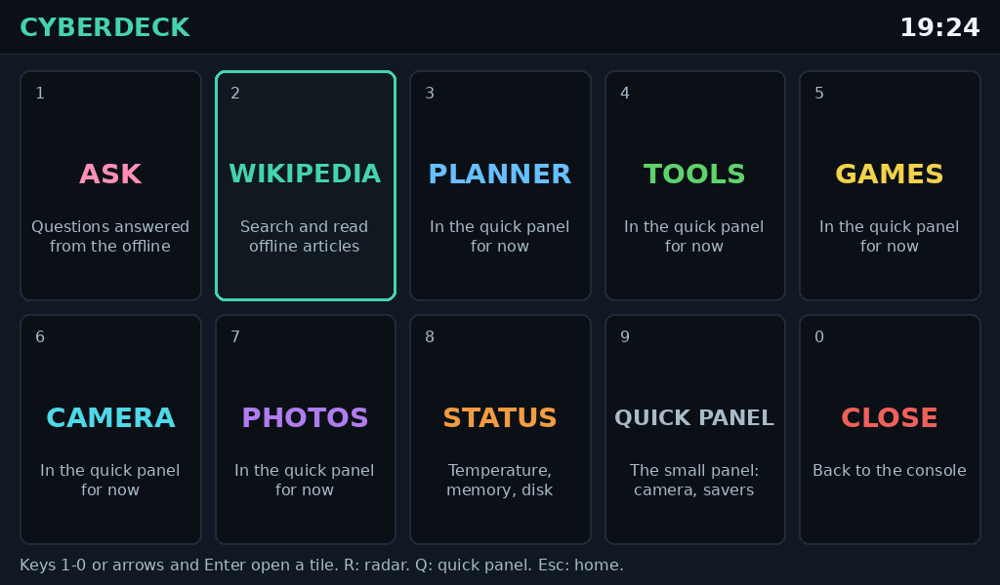
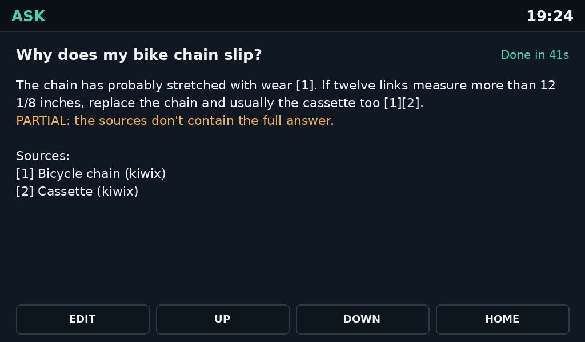
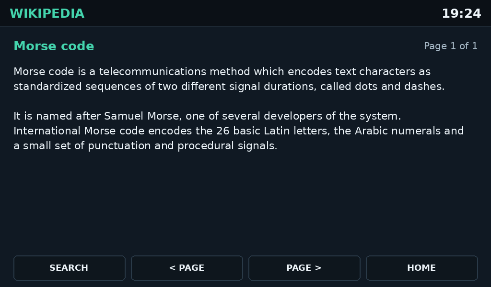
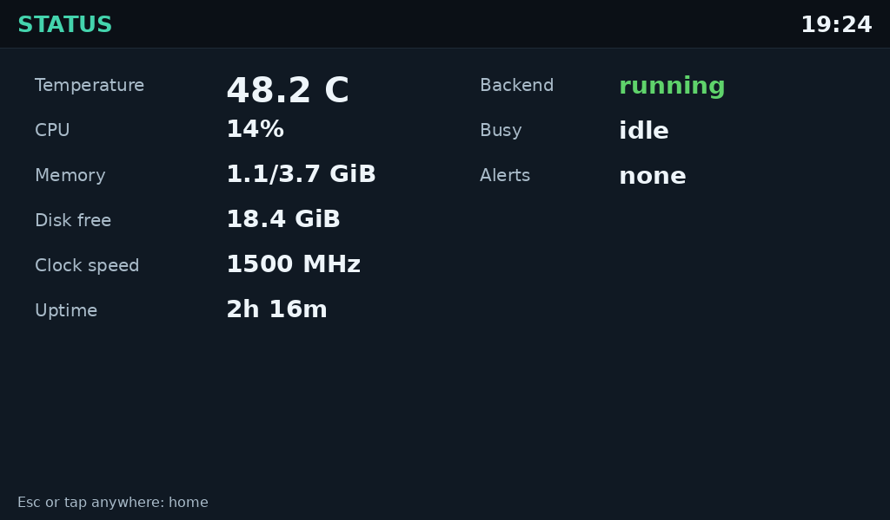
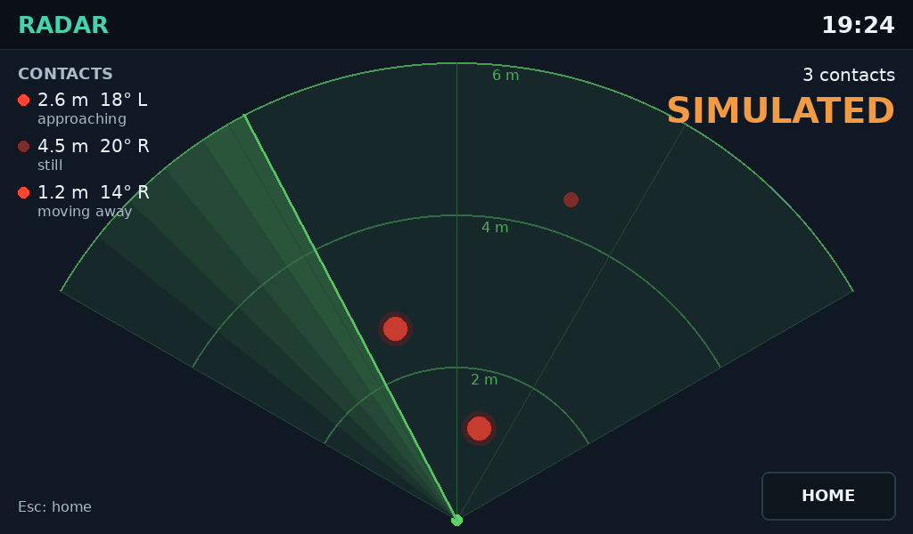

# Main app

The main app is the cyberdeck's full-screen home on the 5" HDMI touch screen. It draws at the
screen's own resolution (1024x600) instead of the quick panel's 320x240 page scaled up. Like
the quick panel (`panel_app.py`), it draws straight to the framebuffer with no desktop, which
leaves the most memory for Ollama.



## Running it

The Pi must boot to the console, as for the quick panel on HDMI (see [HDMI-SCREEN.md](HDMI-SCREEN.md#running-it)).

```
sudo python3 ~/cyberdeck-repo/main_app.py
```

Run by hand like this, Ctrl+C on the keyboard closes it, and so does the CLOSE tile. To start
it at boot instead, see [Starting at boot](#starting-at-boot).

The main app and the quick panel can't run at the same time, because they share the screen,
touch and keys. If the quick panel is running as the boot service, stop it first with
`sudo systemctl stop cyberdeck-panel`. Otherwise the main app stops and says the quick panel is
running.

## Using it

| Key | Does |
| --- | --- |
| `1` to `9`, `0` | Open that tile |
| Arrows, then Enter | Pick a tile and open it |
| `R` | Open RADAR |
| `Q` | Open the quick panel |
| Esc | Back to home |
| Ctrl+C | Close the main app (under the boot service: back to home) |

Touch works on every tile. It uses the quick panel's calibration (`~/cyberdeck-data/touch.json`).
If the quick panel hasn't calibrated this touch device yet, the main app says so. Press `Q`,
let the quick panel calibrate, then come back.

## The main app and the quick panel

While both share the 5" screen, only one runs at a time:

- **QUICK PANEL** (or `Q`) closes the main app and starts the quick panel in its place.
- The quick panel's **EXIT** page then shows **MAIN APP** instead of CLOSE APP, which hands the
  screen back.
- Tiles for apps that haven't moved here yet (Planner, Tools, Games, Camera, Photos) open the
  quick panel straight on that app. Leaving it through EXIT → MAIN APP returns
  here.

The quick panel takes these options for this:

- `--open PAGE` starts it on `ask`, `reader`, `planner`, `tools`, `games`, `camera` or `photos`.
- `--main-app` makes its EXIT page hand the screen back.

The plan is for the apps to move into the main app one at a time. Ask and Wikipedia have moved
already. Later, the 2.8" screen can run the quick panel full time beside the main
app on the 5".

## Ask



**ASK** (`1`) puts a question to the offline librarian, the same as the quick panel's ASK and
`deck ask`. To ask, type the question and press Enter, or tap one of the recent and example
questions.

- The answer streams in as the model writes it, and its sources are listed under it.
- The same warnings appear in yellow: UNVERIFIED, PARTIAL, QUOTED, and when the sources don't
  contain an answer.
- While it answers, the bottom-left button is **STOP**. Afterwards it is **EDIT**, which brings
  the question back to change it.
- UP and DOWN (or the arrow keys, Page Up and Page Down) scroll a long answer.
- Esc stops or edits, then goes home.

The backend (`cyberdeck-core`) must be running. If it isn't, ASK says so and doesn't answer.

## Wikipedia



**WIKIPEDIA** (`2`) searches the offline library (every ZIM that kiwix-serve has, plus local
documents) and shows an article as text. Pictures and tables are left out.

- Type a search and press Enter. Number keys `1` to `6` open a result, or tap it.
- Arrows, Space, Page Up and Page Down turn the article's pages. So does tapping the left or
  right of the text.
- Long articles show their first part only, and say so at the end.
- Typing in the results or the article starts a new search.
- Esc goes back a step, and from the search box back to home.

Typing needs the keyboard here. The quick panel's READER still has an on-screen keyboard.

## Status



**STATUS** (`8`) shows the temperature, CPU, memory, free disk, clock speed and uptime. These
are read on the Pi, the same way the quick panel reads them. It also shows whether the backend
(`cyberdeck-core`) is running and what it is busy with. Health alerts (low voltage, heat,
throttling) show in the header on every page.

## Radar



**RADAR** (`R` from home) shows an HLK-LD2450 radar like a heartbeat sensor. You're at the
bottom centre, and the fan covers what the radar sees: 6 m ahead and 60° to each side, with
arcs at 2, 4 and 6 m. A sweep crosses the fan once a second.

- Each contact is a red dot where the radar puts it. A moving contact pulses with a double
  heartbeat; a still one is dimmer. A dot fades out over about a second when the radar stops
  reporting it.
- The top left lists up to three contacts: distance, bearing (degrees left or right, or
  ahead) and whether it is approaching or moving away.
- The radar reports movement and position, not who or what is moving, so the page says
  "contact", never "person".
- **NO SIGNAL** means the radar has gone quiet for 2 s (wiring or power). The page never shows
  an empty "all clear" fan when it has no data. **No movement** means fresh data with nothing
  moving.
- A recording played back (`--radar replay:...`) says **SIMULATED** in large orange letters the
  whole time.
- **NO RADAR** means cyberdeck-core was started without `--radar`; see
  [CORE.md](CORE.md#radar). **RADAR OFFLINE** means the backend isn't running, and
  **NO RADAR SUPPORT** means its version is too old for `/api/radar`.
- Esc, `Q` or **HOME** goes back. The page asks the backend about 5 times a second while it is
  open, and not at all once you leave.

## Checks

- **Tests:** `tests/test_main_pages.py` covers asking, the notes and buttons, and searching,
  opening and paging an article, with a fake backend. `tests/test_main_app.py` covers the tile layout at 1024x600 and 800x480, the
  arrow keys, the hand-off arguments, drawing on a fake 1024x600 16-bit screen (only changed
  rows are sent), and mapping calibrated taps.
  `tests/test_radar_page.py` covers every radar state (offline, no radar, NO SIGNAL,
  waiting, no movement, contacts), the SIMULATED label, dots gliding and fading, and polling
  only while the page is open.
- **On the Pi:**
  - The home fills the screen with sharp text.
  - Each tile opens with its number key and by touch, and taps land where you touch.
  - `Q` opens the quick panel, and EXIT → MAIN APP comes back.
  - ASK answers a question, and the text is easy to read from arm's length.
  - WIKIPEDIA finds and opens an article, and the pages turn.
  - RADAR (`R`), with cyberdeck-core started with `--radar`, shows a pulsing dot that
    follows you as you walk in front of the radar, and NO SIGNAL when the radar is unplugged.

## Starting at boot

`setup_main_service.py` installs `cyberdeck-main.service`, which starts the main app on the 5"
screen at boot and restarts it 5 s after a crash. It disables the quick panel's boot service
(the quick panel still opens with `Q`), and it conflicts with the desktop: starting one stops
the other.

```sh
sudo python3 ~/cyberdeck-repo/setup_main_service.py --console-boot --now
```

`--console-boot` makes the Pi boot to the console instead of the desktop. Without it both are
queued at boot and only one of them starts, so either may win; use `--console-boot`. `--now`
also starts it straight away.

| To | Run |
| --- | --- |
| Use the desktop (SDR++) | `sudo systemctl start lightdm` (stops the main app) |
| Go back to the main app | `sudo systemctl start cyberdeck-main` (stops the desktop) |
| Watch its log | `journalctl -u cyberdeck-main -f` |
| Remove it | `sudo python3 ~/cyberdeck-repo/setup_main_service.py --undo` |
| Start the quick panel at boot again | `sudo systemctl enable cyberdeck-panel` (after removing it) |
| Boot to the desktop again | `sudo systemctl set-default graphical.target` |

Under the service Ctrl+C goes back to home, because a clean exit isn't restarted. CLOSE is the
deliberate way out; `sudo systemctl start cyberdeck-main` brings it back. While this service is
enabled, the quick panel's OPTIONS shows **Start at boot: Main** and won't turn on its own boot service.
