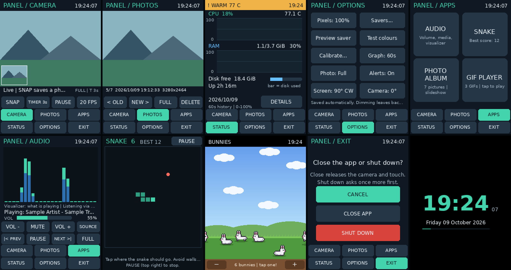
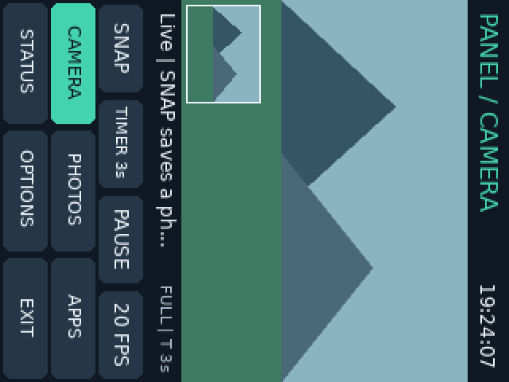

# Panel app: rotating the whole UI (portrait mode)



*Each screen above is drawn by the app's own code, shown the right way up for you once the deck is turned. Below is the same Camera screen as the panel itself receives it: turned 90° clockwise, so the top of the UI sits on the panel's right edge.*



## What changed

- **The whole app can be turned.** Every page, the full-screen apps, the screensavers, the calibration crosses and the "not running" and shutdown screens all rotate. The new setting is **OPTIONS → Screen**, which cycles **90° CW → Landscape → 90° CCW → 180°**.
- **90° clockwise is the default**, as you asked. The first time you run this version, it starts rotated.
- **Layouts are rebuilt for portrait, not shrunk:**

| Screen | Portrait layout |
| --- | --- |
| Tabs | Two rows of three: CAMERA PHOTOS APPS on top, STATUS OPTIONS EXIT below. |
| Camera | The preview fills the full width (240×180, previously 176×132). The *last photo* thumbnail sits in the preview's corner (tap it to open Photos), with size and timer shown beside the message. |
| Photos | Same larger picture. Buttons read **< OLD / NEW >** to fit. |
| Status | Taller CPU and RAM graphs. The Details page has more line spacing. |
| Options, Screensavers, style picker | Two-column grids with taller buttons. Some labels are shorter in portrait, e.g. *Pixels: 100%*, *Calibrate...*, *Alerts: On*. |
| Exit | CANCEL, CLOSE APP and SHUT DOWN stacked as three full-width buttons. Shut down still asks a second time. |
| Apps | Taller tiles. Names and notes wrap onto two lines. |
| Audio | A taller visualizer, with the same two button rows. |
| Snake | The board becomes 19×20 cells instead of 26×14. Rotating mid-game starts a fresh board, since the shape changes. |
| Bunnies, Clock, Radar, Starfield, album, GIFs | Fill the tall screen. Bunnies get extra sky and clouds. Album and GIF pictures are letterboxed into 240×320. |

- **Touch follows the rotation automatically.** Your saved calibration is still used, because it's stored in the panel's own coordinates. Taps are then turned the same way as the picture. No recalibration is needed. If you do recalibrate, the crosses and text appear upright for whatever rotation is set.
- **Buttons respond exactly where they're drawn.** Each button now records its own hit area as it's drawn. A tap can never land on a button from a different layout.

### Camera turn

The camera feeds the same image whichever way the screen is turned. If the preview looks sideways once the deck is rotated, use **OPTIONS → Camera turn** (0°, 90°, 180° or 270°, clockwise) until it's upright. This applies to the live preview, paused frames and saved photos (full-resolution and 320×240). Photos you've already saved aren't changed.

## Install

1. Stop the app: `sudo systemctl stop cyberdeck-panel`, or Ctrl+C if you started it by hand.
2. Back it up: `cp ~/panel_app.py ~/panel_app.previous.py`
3. Copy the new file from Windows: `scp panel_app.py eli@cyberdeck.local:/home/eli/`
4. Start it: `sudo systemctl start cyberdeck-panel`, or `sudo python3 ~/panel_app.py`.

You don't need to change `config.txt`, the `rotate=` overlay setting, SPI, or the touch-isolation setup. The framebuffer stays 320×240; the app turns the picture itself.

## If it's turned the wrong way, or touch feels off

- **Wrong direction:** tap **OPTIONS → Screen** until it's upright. The setting is saved.
- **Can't reach the menu:** start the app once with a fixed rotation, which isn't saved:

  ```bash
  sudo systemctl stop cyberdeck-panel
  sudo python3 ~/panel_app.py --rotation 0
  ```

  Then set **OPTIONS → Screen** as you like, close the app and start the service again.
- **Taps land in the wrong place in every orientation:** the calibration itself is off, not the rotation. Use **OPTIONS → Calibrate** or `--calibrate`, as before.

## Checks

All 40 automated tests pass (`python3 -m unittest discover -s tests -v`):

- **Coordinates:** for 0°, 90°, 180° and 270°, a marked pixel lands exactly where the touch mapping says it should after the image is turned for the panel, and panel ↔ screen coordinates convert back and forth exactly. At 90° clockwise, the top-left of the UI lands at the panel's top-right.
- **Portrait pages:** every page renders at 240×320 with every button inside the screen. The six tabs sit in two rows. Bunnies, Radar, Starfield, Clock and Snake fit, and the bunnies' + button works in its new spot. Rotating back during Snake starts a fresh landscape board.
- **Real application loop in portrait:** with a simulated screen, touch and camera: SNAP → Photos → Delete → confirm → Options → Screen (back to landscape) → Exit → Close app. It checks that the photo was captured and removed, the setting was saved, and the screen switched size.
- **Landscape unchanged:** all the earlier tests, including the landscape app loops, still pass.

**Still needs checking on the Pi:**

- **Direction:** whether 90° clockwise is the way you hold the deck.
- **Taps:** whether they line up in portrait; they should, using your existing calibration.
- **Camera:** whether the preview needs **Camera turn** to be upright.
