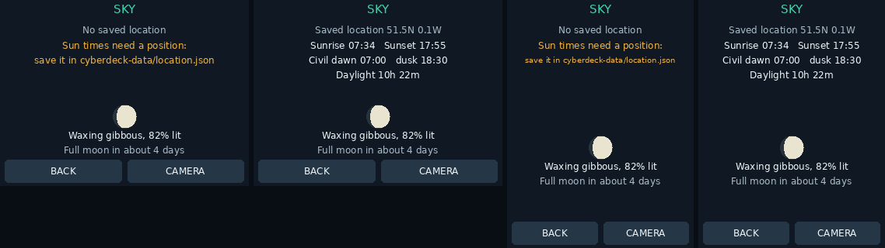

# Camera and deck tools

Open **APPS > TOOLS**. The menu has two pages; use **MORE** for Recovery, Updates
GNSS and Sun & moon. **APPS > QUICK CONTROLS** opens the shortcuts directly. Layouts support
all four screen rotations. The original camera, calibration, savers, audio and
games remain available.

## Install this branch on the Pi

Stop the old app with its Close button or Ctrl+C. If it runs at boot, stop that
copy first:

```bash
sudo systemctl stop cyberdeck-panel
cd ~/cyberdeck-repo
git fetch origin
git switch feature/panel-tools
git pull --ff-only
sudo python3 panel_app.py
```

If Git reports local changes, stop and preserve those changes before switching.
Do not reset or delete your checkout. This release includes the `panel_tools/`
package: keep the whole repository together, rather than copying only
`panel_app.py`. It uses the existing Pillow, NumPy, Picamera2 and evdev packages;
the new tools use Python's standard library and Git. No web framework is needed.

For an existing boot service, after testing and closing the manual copy:

```bash
cd ~/cyberdeck-repo
sudo python3 setup_panel_service.py --now
```

This repoints the service at this checkout if it previously ran a copy elsewhere.
Never run the manual app and service simultaneously.

## Where photos and settings live

The default is now **`/home/eli/cyberdeck-data`** (the invoking user's home, including
when run through sudo or the existing boot service). Code updates no longer move
your photos, presets, games or touch calibration.

If that folder does not exist but `cyberdeck-data` beside `panel_app.py` does, the
app copies the complete old folder first, preserves the original, then uses the
new folder. An interrupted copy is left as `cyberdeck-data.migrating` and reported
for inspection; it is never silently merged or overwritten. Enough free space
for the copy is required. If the home folder already exists, it wins and the
repo-adjacent folder stays untouched. Check which contains your latest settings
if you've previously used both locations.

You can keep an explicitly chosen folder instead:

```bash
sudo python3 panel_app.py --data /home/eli/cyberdeck-repo/cyberdeck-data
```

The service installer records the chosen data folder explicitly, so rolling back
to an older app version still uses the same photos/settings after reboot. To
use a custom folder for the service, run `sudo python3 setup_panel_service.py
--data /your/folder --now` (one command). Custom service overrides with `--data`
keep that argument. Keep your own backup of important photos/settings.

## Tools

| Tool | Controls and behavior |
| --- | --- |
| Quick controls | Volume +/−, mute, immediate photo, saver, confirmed shutdown. Uses your existing desktop audio backend. |
| Timelapse | Choose 5/10/30/60-second intervals and 1/5/15/30/60-minute duration. START saves full-resolution JPEGs in `photos/`; STOP ends the sequence. Shows saved count, remaining time, estimated total storage and actual free space. Runs across pages and screensavers. |
| Timers | Stopwatch start/pause/reset and 1/5/10/25/60-minute countdown. Completion wakes the saver and leaves a banner until you tap it or Dismiss alert. Visual alert, no assumed buzzer/speaker. |
| Network | IPv4/interface and Wi-Fi reading, combined non-loopback receive/send rates and 120-second traffic/signal history. This is interface traffic, not an Internet speed test; VPN/bridge paths may count traffic twice. |
| Presets | Camera, Desk and Quiet defaults. Apply a preset or confirm Save current to replace that slot. Stores display/saver/camera options, camera FPS and available volume/mute settings. |
| Recovery | Retry camera initialization and rediscover the audio backend without restarting the app. Detailed errors also go to the terminal/service journal. |
| GNSS | Deliberate **NO RECEIVER CONNECTED** placeholder with no position, satellite count, speed or altitude. No simulated fixes and no driver assumptions before the module arrives. |
| Sun & moon | Today's sunrise, sunset, civil dawn and dusk, hours of daylight, and the moon's phase with days to the next full or new moon. Computed on the Pi from the date and a saved position; nothing is downloaded. |

Timelapse waits the selected interval **after a photo finishes**, so slow captures
never produce catch-up bursts. The displayed shot count is an upper bound.
Storage estimates use recent JPEG sizes, or 5 MiB per image before any exist;
actual sizes vary with the camera and scene. The existing 200 MiB free-space
guard still applies. A failed capture/save stops the sequence and shows an error.
Timelapse and timers are not resumed after an app restart or power loss.

### Sun & moon



The moon's phase needs no position, so it always shows. Sun times need one, and until
GPS arrives that is a position you save in `~/cyberdeck-data/location.json`:

```json
{"lat": 51.51, "lon": -0.13}
```

Latitude is positive north, longitude positive east (so west is negative). The page
reads the file each time it draws, so changes show at once. Without a valid file it
says **No saved location** and shows no sun times rather than guessing a city.

Times are in the Pi's time zone and good to a minute or two; the moon phase can be
up to half a day off. Near the poles the page says when the sun stays up or down all day.

## Photo zoom and sharing

**PHOTOS > FULL** loads the original picture in the background. Use +/− for
1×–64× relative to fit-to-screen and the arrows to pan. BACK returns to Photos.
The full-size image is decoded once, and the current viewport is cached.

**TOOLS > Photo sharing** lets you browse filenames and select individual saved
photos. **Start sharing** opens port 8765 for ten minutes. Type the two displayed
URL lines as **one continuous address** in a browser on the same private LAN.
Only the selected JPEG/PNG files are exposed; there is no upload, delete or folder
browsing endpoint. A fresh random URL token is generated for every session.
Stop sharing revokes that session, and expiry is also checked on every request.

This is plain HTTP for a trusted private network, not a public photo server.
Anyone with the complete session link can download the selected photos until it
expires. Do not forward the port to the Internet. Sharing is off at startup.

## Explicit software updates

**TOOLS > MORE > Updates** shows the revision loaded at app startup.

1. **Check GitHub** fetches the current branch's configured remote. It changes no
   app files. Authentication must already work as the checkout's owner; the panel
   won't ask for or store a GitHub password/token.
2. **Update** asks for confirmation, checks for local modifications and divergent
   history, syntax-checks incoming Python files without executing them, records
   the previous revision outside the repo, and performs a fast-forward merge.
3. **Restart app** asks for confirmation and releases the camera/touch before
   reloading. It waits for active capture/save and update jobs.
4. **Roll back** asks for confirmation and checks out the previous recorded
   revision in detached mode, provided the checkout is clean and still matches
   the installed update. It preserves the updated branch and all user data.
   Restart to load the restored version. Future updates require selecting the
   desired branch again in a terminal, e.g. `git switch feature/panel-tools`.

Updates follow **your current tracking branch**, not an assumed `main`. The code
on this feature branch therefore updates from this feature branch until you
switch. No background downloads or automatic installation are scheduled.
Syntax checks do not replace hardware testing. Rollback is for the most recent
update applied through this menu; earlier manual Git changes aren't recorded.
Keep VNC/SSH available for recovery if a future version cannot start.

## Implementation and verification

`panel_tools/camera.py` contains the Picamera2 adapter extracted from the main app;
`runtime.py` owns serialized camera work, jobs, clocks and data paths;
`network.py` handles counters and photo sharing; `updates.py` handles Git;
`ui.py` handles the new pages. The existing display/touch/saver code stays in
`panel_app.py` to keep this change bounded. Camera initialization, preview reads,
full-resolution capture, JPEG saving and camera recovery happen off the UI
thread. One worker owns the camera driver, avoiding overlapping mode switches.

Run hardware-free checks from the repository:

```bash
python3 -m unittest discover -s tests -v
python3 tools/render_tools.py
```

Before relying on the new features on the Pi, check a full-size snapshot while
changing pages, a short timelapse, timer wake-up, photo selection/download, and
your normal touch rotation. The development machine cannot validate the actual
camera driver, framebuffer timing or Wi-Fi/audio devices. Power-supply diagnosis
is outside this update.
